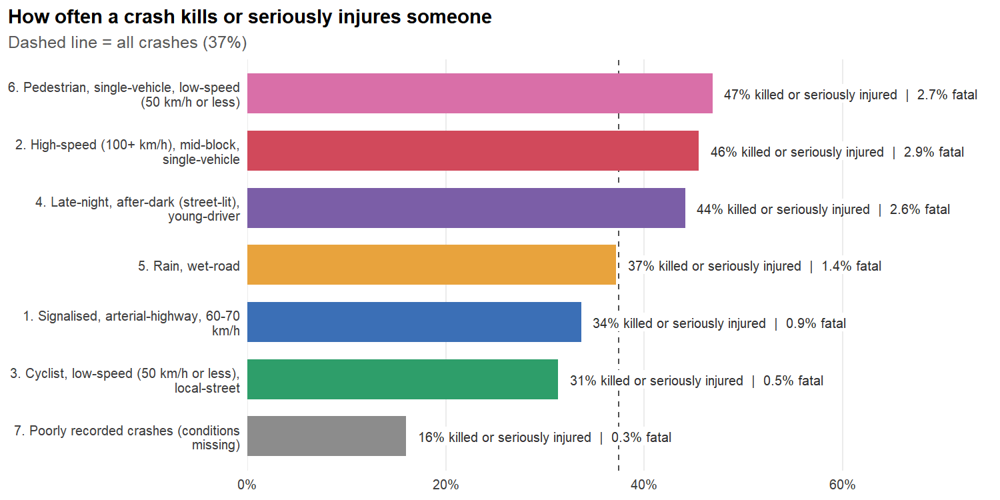
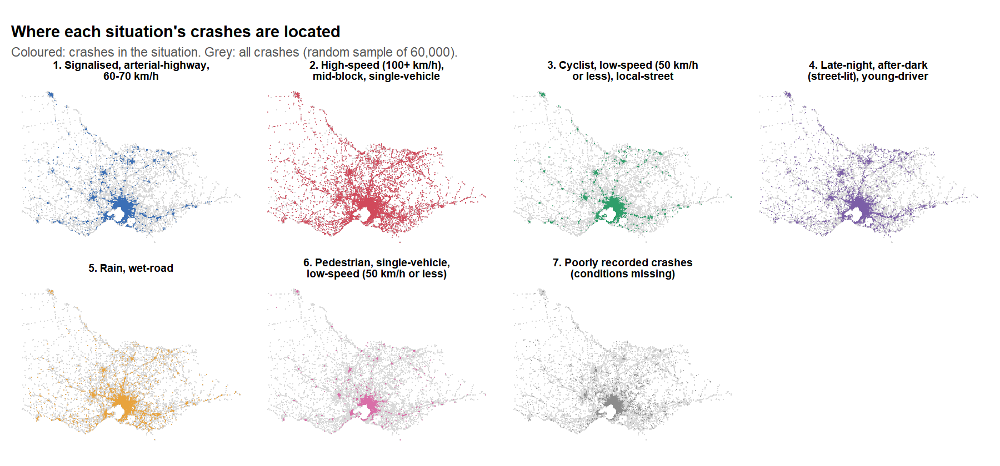
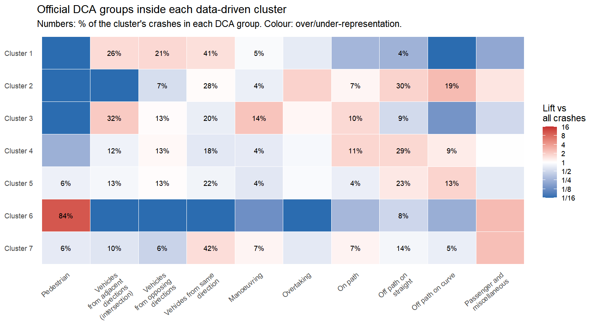

# Where Victoria's road deaths really happen

An R analysis of 182,039 police-reported road crashes in Victoria, Australia (January 2012 to September 2024). It asks one question: if Victoria could make one kind of road situation safer, which would save the most lives?

Police already sort every crash into an official category (a DCA code) that records how it happened, such as "head-on" or "off path on a curve". This project instead groups crashes by the situation they happened in: the speed zone, road type, time, light, weather, and who was involved. It then counts the deaths in each situation and checks what the official categories miss.

This was a group project for a postgraduate big data unit.

[Read the full report](https://kimsongken.github.io/victoria-road-deaths/output/report.html), with the interactive map, a story for each situation, and five recommendations.



## What we found

3,244 people were killed in these crashes, about 254 a year.

| Situation | Share of crashes | People killed | Deaths per 1,000 crashes |
|---|---|---|---|
| High-speed (100+ km/h) roads, mostly rural, often one vehicle | 20% | 1,174 (36%) | 31.9 |
| Night-time, often young drivers | 14% | 731 (23%) | 28.1 |
| Signalised city intersections, 60 to 70 km/h | 25% | 451 | 10.1 |
| Pedestrians | 8% | 403 | 27.4 |
| Rain and wet roads | 10% | 283 | 15.4 |
| Cyclists on low-speed local streets | 16% | 164 | 5.6 |
| Poorly recorded (weather, surface or speed zone missing) | 7% | 38 | 3.2 |

High-speed rural roads and night-time driving account for 59% of deaths but only 35% of crashes. City intersections produce the most crashes, but a high-speed rural crash is 3.2 times as likely to kill someone.

The official categories hide this. Within the single category "vehicles from opposing directions", crashes on high-speed roads killed 132 people per 1,000 crashes, while crashes on low-speed local streets killed 5.6. That is a 24-fold difference under one label.

Adding the situation to the official category also improves a logistic regression that predicts fatal crashes: the AUC rises from 0.68 to 0.73, and a likelihood-ratio test puts the improvement far beyond chance.



## How it works

1. `R/01_prepare.R` joins six of the nine tables in the release (accidents, locations, weather, road surface, vehicles and people) into one row per crash, and builds 17 categorical features describing each crash's situation. Missing values stay as their own "Unknown" level instead of being dropped, which is how the poorly recorded group showed up.
2. `R/02_cluster.R` runs Multiple Correspondence Analysis on all crashes, keeps the 7 dimensions that hold 95% of the Benzécri-corrected inertia, and clusters them with k-means. It tests k from 4 to 14. To be chosen, a solution had to reproduce almost exactly from different random starts and from a held-out half of the data (ARI of at least 0.9). Among those, k = 7 had the best silhouette.
3. `R/03_compare_dca.R` compares the situations with the official categories (cross-tables, adjusted Rand index, normalised mutual information) and fits the severity models.
4. `R/04_profile_stories.R` profiles each situation (deaths, severity, region, over-represented council areas) and writes a plain-English description, a "typical crash" summary, and a real example: the crash whose details are most typical of its situation.
5. `report.Rmd` turns the results into the full report, ending with five recommendations. `app/app.R` is a Shiny and leaflet map with filters for situation, year, severity and region.

The official category, severity and location were left out of the clustering on purpose, so comparing the situations against them is a fair test.



## Limitations

The data has no traffic volumes, so a situation with many deaths may partly reflect how much driving happens in it. Death rates per crash are not affected by this. The clusters are very stable (seed ARI 1.00, subsample ARI 0.96) but not sharply separated (silhouette 0.11): crashes form a continuum, so the situation profiles matter more than any single crash's assignment. A Gower distance and PAM version gave unstable results in testing and is kept only as a cross-check.

## Running it

The crash data is not included in this repository. Download the Victoria Road Crash Data release from [DataVic](https://www.data.vic.gov.au) and put the CSV files in `../data/data` relative to this folder, or point the `CRASH_DATA_DIR` environment variable at them.

```r
install.packages(c("data.table", "dplyr", "tidyr", "stringr", "ggplot2", "scales", "cluster",
                   "FactoMineR", "aricode", "rmarkdown", "knitr", "shiny", "leaflet", "DT"))
```

```bash
Rscript run_all.R
```

The full pipeline takes about 4 minutes on a laptop and writes `output/report.html`. To open the interactive map, run `shiny::runApp("app")` in R.

## Files

```
R/00_config.R            paths, seed, features, colours
R/01_prepare.R           data joining and feature building
R/02_cluster.R           MCA, k-means, choosing k, PAM cross-check
R/03_compare_dca.R       comparison with official categories, severity models
R/04_profile_stories.R   profiles, stories, figures
report.Rmd, report.css   the report
app/app.R                Shiny map
output/report.html       rendered report
output/*.csv             result tables
output/figures/          charts used in the report and this README
```
